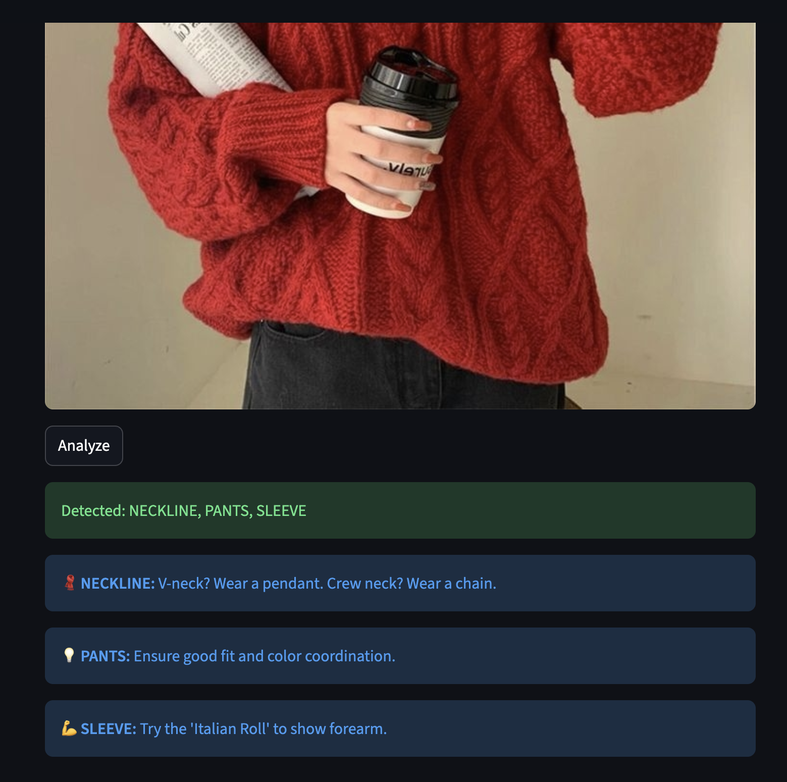
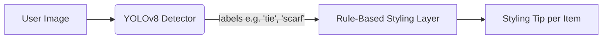

# 👗 StyleAI: Rule-Based Fashion Assistant

StyleAI is a prototype Streamlit app that detects clothing items in an outfit photo and gives simple styling tips. It combines a **YOLOv8 object detector** with a small **rule-based styling layer**: detected items are mapped to styling rules (e.g. the *Sandwich Rule*, the *Third Piece Rule*) to turn labels into actionable advice.

> Status: early prototype. A custom scarf detector can be plugged in via `scarf_model.pt`; without it, the app falls back to the standard YOLOv8n model.

## 📸 Demo

## 🧠 How It Works

1. **Detection:** YOLOv8 (custom scarf model if available, otherwise `yolov8n`) detects items in the photo.
2. **Rules:** Each detected item is matched to a styling rule (scarf → Third Piece Rule, tie → length rule, other items → Sandwich Rule).
3. **Output:** The app shows one tip per detected item.

## 🔭 Next Steps
- Train and publish the custom scarf model weights
- Use CLIP (already loaded) for color and pattern matching
- Add more styling rules (e.g. proportion rules)
